# Исходная страница: структура и полный контент

Источник: https://narkologicheskaya-klinika.ru/narkolog-na-dom/

Снято напрямую с сайта 09.11.2026. Текст исходника, без рерайта. Бренд, контакты и доказательства относятся к ПС КЛИНИКЕ. Сначала читать TASK.md.

Данные слайдеров вынесены также в data/specialist.json и data/reviews.json.

---

## Блок 01: header

HTML: `header`, id=``, class=`header`

[Москва, Загородное шоссе, дом 7, корп. 3](https://narkologicheskaya-klinika.ru/contacts/)

[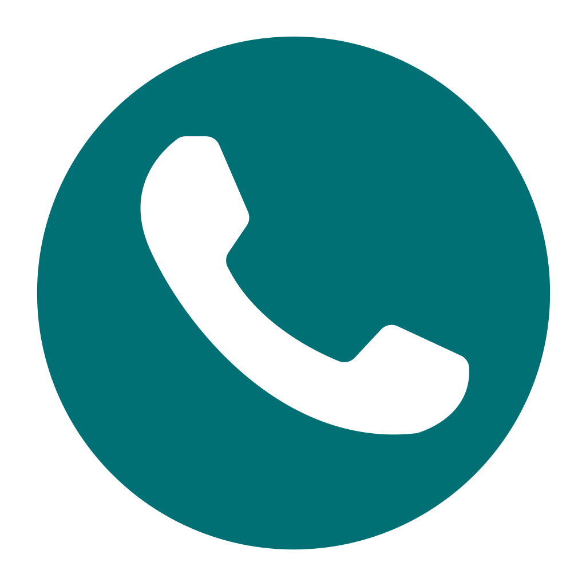](tel:+7 (499) 110-40-03)

Получить консультацию

[+7 (499) 110-40-03](tel:+74991104003)

Работаем круглосуточно

- [О клинике](https://narkologicheskaya-klinika.ru/about/) - [Специалисты](https://narkologicheskaya-klinika.ru/specialist/) [Цены](https://narkologicheskaya-klinika.ru/price/) [Отзывы](https://narkologicheskaya-klinika.ru/reviews/) [Лицензии и сертификаты](https://narkologicheskaya-klinika.ru/about/license/) [Блог](https://narkologicheskaya-klinika.ru/blog/) [Диагностика и лечение](https://narkologicheskaya-klinika.ru/services/) [Контакты](https://narkologicheskaya-klinika.ru/contacts/)

- [Лечение алкоголизма](https://narkologicheskaya-klinika.ru/services/alcoholism/) - [Вывод из запоя](https://narkologicheskaya-klinika.ru/services/vyvod-iz-zapoya/) - [Лечение в стационаре](https://narkologicheskaya-klinika.ru/services/lecheniye-v-statsionare/) - [Нарколог на дом](https://narkologicheskaya-klinika.ru/services/ndm/) - [Диагностика алкоголизма](https://narkologicheskaya-klinika.ru/services/diagnosis-of-alcoholism/) - [Мотивация на лечение](https://narkologicheskaya-klinika.ru/services/motivatsiya-na-lecheniye/) - [Реабилитация алкозависимых](https://narkologicheskaya-klinika.ru/services/reabilitatsiya-alkozavisimykh/) - [Амбулаторное лечение](https://narkologicheskaya-klinika.ru/services/ambulatornoye-lecheniye/) - [Кодирование от алкоголизма](https://narkologicheskaya-klinika.ru/services/kodirovaniye-ot-alkogolizma/) - [Пост-реабилитационная поддержка (ПЛП)](https://narkologicheskaya-klinika.ru/services/postreabilitatsionnaya-podderzhka/)

- [Лечение наркомании](https://narkologicheskaya-klinika.ru/services/drug-addiction/) - [Лечение в стационаре](https://narkologicheskaya-klinika.ru/services/lecheniye-narkomanii-v-statsionare/) - [Нарколог на дом](https://narkologicheskaya-klinika.ru/services/nmd2/) - [Мотивация на лечение](https://narkologicheskaya-klinika.ru/services/motivatsiya-na-lecheniye-narkomanii/) - [Виды зависимости](https://narkologicheskaya-klinika.ru/services/vidy-zavisimosti/) - [Амбулаторное лечение](https://narkologicheskaya-klinika.ru/services/ambulatornoye-lecheniye-narkomanii/) - [Двойной диагноз](https://narkologicheskaya-klinika.ru/services/dvoynoy-diagnoz-pri-narkozavisimosti/) - [Пост-реабилитационная поддержка (ПЛП)](https://narkologicheskaya-klinika.ru/services/post-podderzhka-pri-narkozavisimosti/)

- [Нарколог на дом](https://narkologicheskaya-klinika.ru/services/narkolog-na-dom/) - [Нарколог на дом](https://narkologicheskaya-klinika.ru/services/nmd3/)

- [Отделение психиатрии](https://narkologicheskaya-klinika.ru/services/psychiatry/)

- [Помощь родственникам](https://narkologicheskaya-klinika.ru/services/pomoshch-rodstvennikam/)

- [Реабилитация](https://narkologicheskaya-klinika.ru/services/rehabilitation/) - [Реабилитация наркозависимых](https://narkologicheskaya-klinika.ru/services/rehabilitation-of-drug-addicts/) - [Реабилитация алкозависимых](https://narkologicheskaya-klinika.ru/services/rehabilitation-of-alcohol-addicts/) - [Другие зависимости](https://narkologicheskaya-klinika.ru/services/drugiye-zavisimosti/) - [Экскурсия в Реабилитационный Центр](https://narkologicheskaya-klinika.ru/services/ekskursiya-v-reabilitatsionnyy-tsentr/) - [Программы реабилитации](https://narkologicheskaya-klinika.ru/services/rehabilitation-programs/) - [Медико-психологическая реабилитация](https://narkologicheskaya-klinika.ru/services/mediko-psikhologicheskaya-reabilitatsiya/) - [Социальная реабилитация](https://narkologicheskaya-klinika.ru/services/social-rehabilitation/) - [Двойной диагноз](https://narkologicheskaya-klinika.ru/services/dvoynoy-diagnoz/) - [Амбулаторная реабилитация](https://narkologicheskaya-klinika.ru/services/ambulatornaya-rehabilitation/)

[Телефон +7 (499) 110-40-03](tel:+74991104003)

RU

EN

Получить консультацию

[Москва, Загородное шоссе, дом 7, корп. 3](https://narkologicheskaya-klinika.ru/contacts/)

---

## Блок 02: Нарколог на дом в Москве и Московской области

HTML: `section`, id=``, class=`hero`

24/7 Круглосуточная медицинская помощь

# Нарколог на дом в Москве и Московской области

Вывод из запоя

Детоксикация

Экстренное восстановление

Комплексная медицинская помощь

24/7 наши специалисты оказывают оперативную помощь на дому — конфиденциально и деликатно.

[Вызвать врача](tel:+74991104003)
Проконсультироваться со специалистом

24/7 — выезд врачаОперативная помощьКонфиденциально и деликатно

Дежурный специалистОценит ситуацию и подберет решение[+7 (499) 110-40-03](tel:+74991104003)

---

## Блок 03: trust-bar

HTML: `aside`, id=``, class=`trust-bar`

Лицензия Минздрава № Л041-01137-77/00355283

Собственный стационар Медицинская помощь под постоянным контролем специалистов.

Гарантия конфиденциальности С уважением относимся к вашим личным данным

---

## Блок 04: Когда стоит обратиться за помощью

HTML: `section`, id=`situations`, class=`section`

Когда нужна помощь

## Когда стоит обратиться за помощью

01. Длительное употребление алкоголя

02. Тяжёлое похмелье

03. Признаки интоксикации

04. Резкое ухудшение самочувствия

05. Пациент отказывается ехать в клинику

06. Пациент не признает проблему

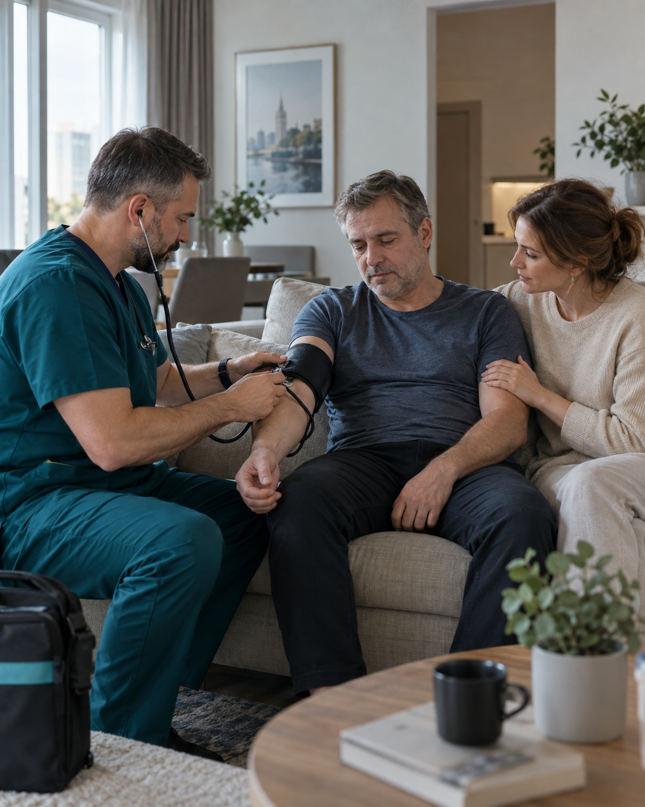

---

## Блок 05: section actions-banner

HTML: `section`, id=``, class=`section actions-banner`

[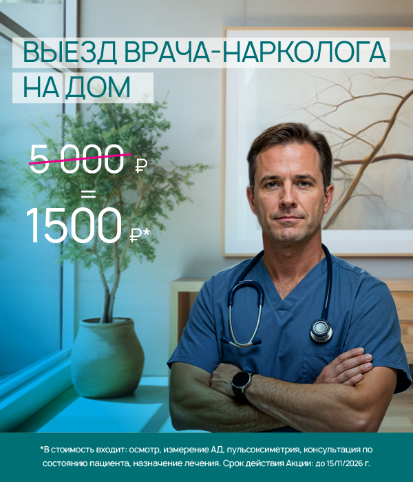](https://narkologicheskaya-klinika.ru/narkolog-na-dom/)
[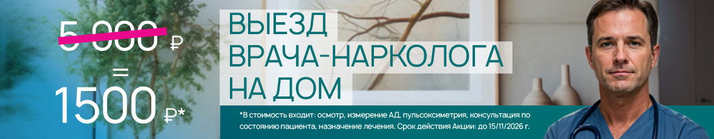](https://narkologicheskaya-klinika.ru/narkolog-na-dom/)

---

Текст баннера (прочитан с desktop-изображения):

- «ВЫЕЗД ВРАЧА НАРКОЛОГА НА ДОМ».
- Зачёркнутая цена: 5 000 ₽. Цена по акции: 1 500 ₽*.
- «В стоимость входят: осмотр, измерение АД, пульсоксиметрия, консультация по состоянию пациента, назначение лечения. Срок действия Акции: до 15/11/2026 г.».

Акция исходного сайта. Для ПНП требуется подтверждение условий и переработка оформления.

---

## Блок 06: impact-stat-wrap

HTML: `aside`, id=``, class=`impact-stat-wrap`

1 300

семей получили помощь в 2025 году

Чем раньше оказана медицинская помощь, тем ниже риск осложнений и тяжёлых последствий для здоровья. При ухудшении состояния не откладывайте обращение к врачу.

По статистике Клиники

---

## Блок 07: Помощь в домашних условиях

HTML: `section`, id=`services`, class=`section`

Услуги

## Помощь в домашних условиях

01

### Осмотр и консультация врача-нарколога

Врач оценит состояние и подберет план лечения.

от 1 500 ₽[Узнать стоимость](tel:+74991104003)

02

### Вывод из запоя на дому

Помощь на дому — только при только при отсутствии отягчающих факторов.

от 3 500 ₽[Узнать стоимость](tel:+74991104003)

03

### Помощь при похмелье и интоксикации

Оценка медицинских рисков и симптоматическая помощь.

от 5 000 ₽[Узнать стоимость](tel:+74991104003)

04

### Капельница для экстренного восстановления

Состав и объем капельницы подбираются индивидуально.

от 3 500 ₽[Узнать стоимость](tel:+74991104003)

05

### Кодирование на дому

Возможность и метод обсуждаются с врачом индивидуально.

от 15 000 ₽[Узнать стоимость](tel:+74991104003)

---

## Блок 08: Дом или стационар: врач определит безопасный формат помощи

HTML: `section`, id=``, class=`section soft clinical-pattern`

Безопасный формат

## Дом или стационар: врач определит безопасный формат помощи

Первичная точка принятия решенияОсмотр и оценка состояния врачом

### Помощь дома

- Состояние позволяет провести процедуру вне клиники

- Пациент согласен на помощь

- Врач контролирует основные показатели

### Необходим стационар

- Высокие медицинские риски

- Состояние требует постоянного наблюдения

- Необходимы дополнительные обследования

Окончательное решение принимает врач после оценки состояния пациента. Госпитализация проводится при добровольном согласии пациента.

---

## Блок 09: специалисты КЛИНИКИ

HTML: `section`, id=`specialists`, class=`specialists first-page`

## специалисты КЛИНИКИ

[Смотреть все](https://narkologicheskaya-klinika.ru/specialists/)

[Смотреть все](https://narkologicheskaya-klinika.ru/specialists/)

### Панов Александр Леонтьевич

Главный врач. Психиатр, психиатр-нарколог

Стаж: 31 год

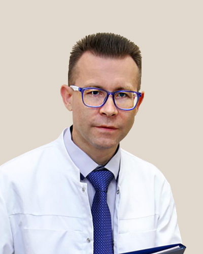

### Круглов Владимир Альбертович

Психиатр-нарколог

Стаж: 21 год

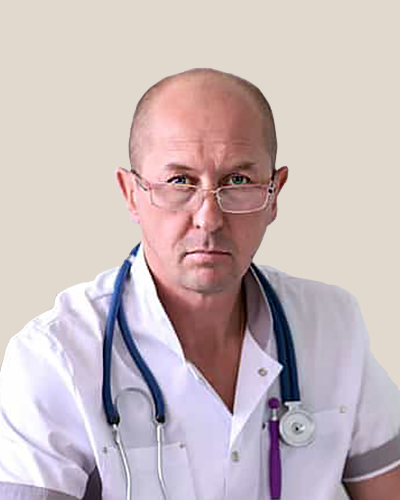

### Сахаров Сергей Владимирович

Психиатр-нарколог, психотерапевт

Стаж: 33 года

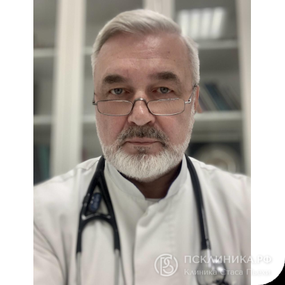

### Рева Виталий Петрович

Клинический психолог-реабилитолог

Стаж: 17 лет

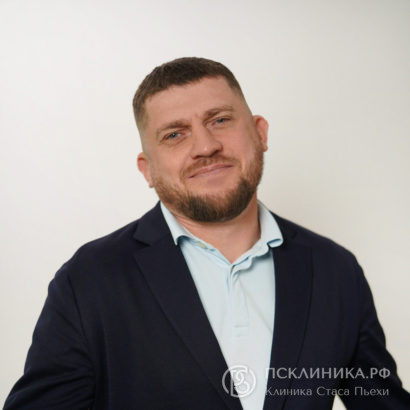

### Моисеев Дмитрий Борисович

Клинический психолог, Аналитический психолог

Стаж: 10 лет

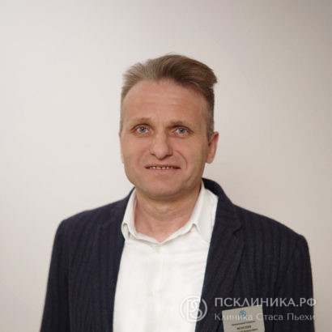

### Шаврина Екатерина Васильевна

Клинический психолог

Стаж: 14 лет

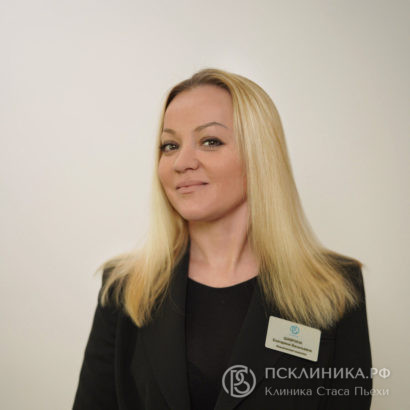

### Зайцев Александр Владимирович

Клинический психолог. Психоаналитик

Стаж: 15 лет

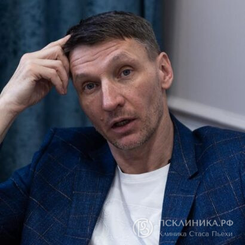

### Юдина Людмила Владимировна

Клинический психолог, когнитивно поведенческая психотерапия

Стаж: 15 лет

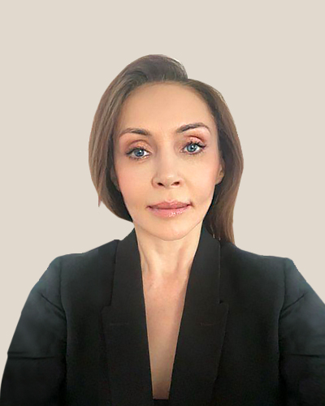

---

## Блок 10: Комплексная медицинская помощь

HTML: `section`, id=``, class=`section dark-section protocol-pattern medical-protocol`

Медицинский протокол

## Комплексная медицинская помощь

- 01Осмотр пациента и сбор анамнеза

- 02Контроль основных показателей

- 03Индивидуальный подбор терапии

- 04Индивидуальный состав капельницы

- 05Строго под наблюдением врача

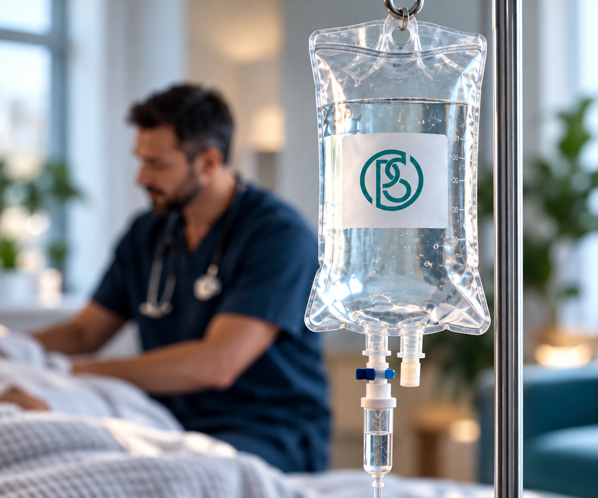

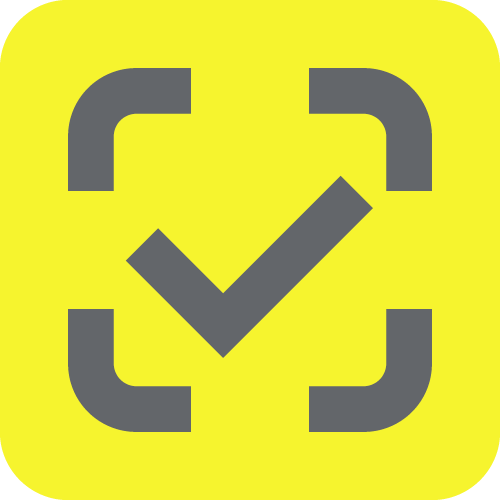

Контроль качества препаратов

Государственная маркировка препаратов и расходных материалов в ГИС МТ «Честный ЗНАК»

---

## Блок 11: Комплексные варианты помощи

HTML: `section`, id=`prices`, class=`section`

Стоимость

## Комплексные варианты помощи

### Лайт

Для запоя продолжительностью 1–2 дня

#### Что входит

- Приедем в течение 60 минут

- Выезд врача на дом

- Первичный осмотр и сбор анамнеза

- Оценка состояния и медицинских рисков

- Индивидуальный состав капельницы

- Контроль состояния во время процедуры

- Рекомендации врача после процедуры

- Поддержка после обращения — до 12 часов

от 3 500 ₽

[Уточнить стоимость](tel:+74991104003)

### Оптимум

Для запоя продолжительностью 3–7 дней

#### Что входит

- Приедем в течение 60 минут

- Выезд врача на дом

- Расширенный осмотр и сбор анамнеза

- Оценка состояния и медицинских рисков

- Индивидуальный состав капельницы

- Расширенный объём терапии по показаниям

- Контроль состояния во время процедуры

- Рекомендации врача после процедуры

- Поддержка после обращения — до 12 часов

- Сопровождение в течение следующего дня

от 6 500 ₽

[Уточнить стоимость](tel:+74991104003)

### Премиум

Для запоя продолжительностью 7–14 дней

#### Что входит

- Приедем в течение 60 минут

- Выезд врача на дом

- Углублённый осмотр и сбор анамнеза

- Расширенная оценка состояния и медицинских рисков

- Индивидуальный состав капельницы

- Усиленный объём терапии по показаниям

- Продолжительный контроль состояния

- Рекомендации врача и дальнейший план лечения

- Поддержка после обращения — до 12 часов

- Сопровождение в течение двух дней

от 11 500 ₽

[Уточнить стоимость](tel:+74991104003)

Точный состав терапии и окончательная стоимость определяются врачом после осмотра и оценки состояния пациента. При наличии медицинских рисков врач может рекомендовать госпитализацию.

---

## Блок 12: Отзывы о нас с независимых ресурсов

HTML: `section`, id=`reviews`, class=`reviews`

## Отзывы о нас с независимых ресурсов

[Смотреть все](https://narkologicheskaya-klinika.ru/reviews/)

[Смотреть все](https://narkologicheskaya-klinika.ru/reviews/)

### Рейтинги площадок

- Yandex: 5. https://yandex.ru/maps/org/klinika_stasa_pyekhi/1032905009/reviews

- Google: 4.5. https://goo.gl/maps/GrfUYj9XmbPFetsM7

- 2GIS: 4.8. https://2gis.ru/moscow/firm/70000001030178272

- Vell: 4.9. https://www.yell.ru/moscow/com/narkologicheskaya-klinika-stasa-pexi-na-zagorodnom-shosse-7k3_11919641/

- Zoon: 4.3. https://zoon.ru/msk/medical/narkologicheskaya_klinika_psklinikarf/

### Отзыв 01. Stas Zelentsov

Дата: 28 января 2026. Оценка: 5

Сам приехал после Новогодних затяжных праздников, Потому что уже знал заранее какой будет эффект:
Позвонил, забронировал место , доехал,
Через час со мной у же беседовал доктор.
После обязательно осмотра и ЭКГ, для меня подобрали набор из лекарств . И ввиде капельниц уже через полчаса в чистой двухместной палате заботливые сестры профессионально всё установили .
Обед уборка это тоже на уровне.
Главное схема лечения, на третий день ,, давление норм , здоровый цвет лица.
С благодарностью всей команде

### Отзыв 02. NataliaNetPositive

Дата: 16 января 2026. Оценка: 5

Так случилось, что пришлось обратиться в клинику, порекомендовали клинику Стаса Пьехи. Совершенно не знали, что певец открыл её с пониманием проблемы алкоголизма, вытрезвления, выводов из запоя, пока везла мужа в такси немного ознакомилась, но не знала как это и что там. Встретил дежурный доктор, так как приезд был ночью, сразу измерили давление, ЭКГ, небольшой опрос и мужа отвели в палату. Так как нам нужно было быстро прийти в себя, оставался только на сутки, с дополнительными комплексами капельниц. Можно остаться по стандартной программе, а можно попросить доп.курс (платно), чтобы быстро в себя прийти. Очень актуально для тех, кому на работу нужно. Но рекомендуют обычно на 3 дня под присмотром с питанием, работает психолог.

### Отзыв 03. Каролина

Дата: 13 января 2026. Оценка: 5

Выражаю огромную, искреннюю благодарность врачу-психиатру СП
клиники — Александру Леонтьевичу Панову и всему коллективу центра

Скажу честно, очень волновалась и переживала перед приёмом, но, как только вошла на территорию, эти чувства испарились, клиника со входа окутывает атмосферой тепла и спокойствия, всё продумано до мелочей и комфорта пациентов: уютная зона ожидания, отдельная гардеробная, доброжелательный персонал, тактичный администратор Екатерина (отдельная благодарность за вкусный чай). Пока было время изучала на стене фоторамки с напутствиями основателю центра, что тоже приободрило.

Огромное Спасибо хочу сказать главному врачу Панову Александру Леонтьевичу, с которым мы проводили первичную консультацию. С первой же минуты общения с Александром Леонтьевичем появилось ощущение, что я — не просто «пациент», а человек, которого готовы выслушать и понять. Его опрос был настолько внимательным, детальным и, что важно, бережным, что даже говорить о болезненных вещах стало менее страшно. Чувствуется рука опытного, знающего и неравнодушного специалиста.
Александр Леонтьевич провёл опрос тактично, без давления, создав атмосферу полного доверия и безопасности. Было видно, что он не просто формально собирает анамнез, а действительно вникает в суть проблемы, пытается понять человека изнутри.

К сожалению, в нашей стране отношение к психиатрам остаётся сложным из-за сохранившегося стигматизма, но важно понять, что психиатрия — это медицина, лечащая мозг и психику, как и другие врачи, и не стоит так бояться этого доктора.
У меня появилась настоящая вера в полное выздоровление и выход в ремиссию. Появилась надежда, что можно не просто заглушить симптомы, а постепенно проработать и избавиться от старых травм, триггеров и снова почувствовать вкус к жизни.

Вместе с Александром Леонтьевичем мы подобрали лечение, обсудили дальнейшие действия и договорились о встрече через месяц.
Спасибо клинике за то, что в ней работают такие врачи! Спасибо за ваш труд, за человечность и профессиональный подход. Вы делаете очень важное дело!

### Отзыв 04. Сезим Жеенбекова

Дата: 3 января 2026. Оценка: 5

Обращались по поводу отца, честно руки уже просто опускались. Долго тянули, надеялись, что как-то само рассосется. В клинике спокойно все объяснили, без давления и криков. Очень чисто внутри, нет ощущения больницы, уютное спокойное место. Сотрудники отработали четко, быстро, все доходчиво объяснили, отец сам захотел начать лечение. Отдельно спасибо доктору Янзинову Виктору Владимировичу - все по делу, без лишней воды, но по-человечески.

### Отзыв 05. Елена Л.

Дата: 26 декабря 2025. Оценка: 5

Клинику посоветовали знакомые. Честно, не ожидали чего-то особенного. Но были удивлены отношением персонала, чистотой и порядком внутри. Нет хаоса, всё организовано, красивый со вкусом продуманный интерьер. Виталий Петрович Рева подробно объяснил, что происходит в реабилитационном центре и как выстраивается лечение. Чувствуется, что команда реально заточена на результат, а не “просто полежать”.

### Отзыв 06. Наталья

Дата: 6 декабря 2025. Оценка: 5

Была тяжелая ситуация – ломка, агрессия, всё плохо. Врачи приехали быстро, поставили капельницу, успокоили, помогли. Всё чётко и спокойно, без лишних слов. Отдельно хочется поблагодарить Сахарова Сергея Владимировича, он настоящий профи, умеет работать даже с самыми сложными.

### Отзыв 07. Аня Кузнецова

Дата: 7 июня 2025. Оценка: 5

ПСКЛИНИКА.РФ Стаса Пьехи - это просто РАЙ для людей страдающих алкогольной зависимостью.
Помимо профессионального лечения докторов, ты получаешь доброе отношение к себе, веру в себя и раскрываешь в себе потенциал для здорового и трезвого образа жизни.
Отдельную благодарность хотелось бы выразить Главному врачу Панову Александру Леонтьевичу, моему лечащему врачу Круглову Владимиру Альбертовичу, а также психиатру-наркологу Янзинову Виктору Владимировичу за их индивидуальный подход к каждому пациенту, за их терпимость к пациентам, доброжелательное отношение и за безусловно высокий профессионализм. Для меня эти врачи герои!!!
Также огромную благодарность хочу от всей души выразить медсестрам ЛЮБОЧКЕ, СВЕТЕ, медбрату ДИМЕ за их отзывчивость, необыкновенную доброту, готовность в любое время оказать квалифицированную помощь и конечно же за хорошее настроение, которое они нам дарили!!!
Благодарю нашу фею - Надежду, которая создавала уют, кормила нас вкусной едой, радовала нас всегда своим позитивным настроением!!!
Низкий всем Вам поклон и процветания!!!

### Отзыв 08. Валерия В.

Дата: 19 мая 2025. Оценка: 5

Обратились за помощью в клинику , по зависимости 🙏попали на прием к доктору Панову А.Л . Специалист высшего уровня , все внимательно выслушал , и дал рекомендации , предложил вариант лечения 🙏не чего не навязывал как это обычно делают в других клиниках ! Все детально и грамотно изложил ! По нашим ощущениям попал прям в цель 🙏у нас теперь есть четкое понимание и уверенность что все попровимо 🙏🙏🙏Дай бог таких специалистов по больше 🙏🙏🙏

### Отзыв 09. allapussi2111

Дата: 11 апреля 2025. Оценка: 5

Обратились в клинику в конце января с отцом, хорошая камерная атмосферная клиника, условия комфортные - светлые палаты, чисто, порядок везде, внимательный персонал, полнейшая анонимность. Колоссальная поддержка от персонала и врачей не только отцу, но и нам родственникам. Хочу сказать спасибо, что не оставляете наедине с бедой, даете шанс на лучшую жизнь.

### Отзыв 10. Лидия Башкирова

Дата: 4 марта 2025. Оценка: 5

Здесь проходит лечение свекровь, мы с мужем довольны не только ее лечением, но и атмосферой в клинике, достойные палаты vip, обслуживание на хорошем уровне, питание отличное. Впереди еще долгий путь, но на данном этапе все устраивает.

### Отзыв 11. Volkech

Дата: 10 февраля 2025. Оценка: 5

Рекомендую от души клинику, в первую очередь за душевное отношение персонала, за заботу и внимание, открытые и отзывчивые, готовые помочь. Для меня это очень ценно и сыграло огромную роль в выздоровлении. Процветания вам и успехов!

### Отзыв 12. Алексей Бутурлакин

Дата: 24 декабря 2024. Оценка: 5

Ребят, выписался 22,12,24. Это не просто клиника, это санаторий какой то, я такой заботы о своём здоровье с СССР не припомню, профессионалы с большой буквы, начиная от нянечек, заканчивая гл. врачом, забота, внимание, обход врачей, медсёстры боги Люба, Александра спасибо вам девочки.В общем если случился недуг, только сюда, не пожалеете. Гл. врач ангел в белом халате, вопросы решаются моментально, я в восторге. СПАСИБО ВСЕМУ ПЕРСОНАЛУ!!! Да, ну и рецепшен, ну само обаяние. Приезжайте, не пожалеете!!! 

### Отзыв 13. Cнежанна П.

Дата: 22 декабря 2024. Оценка: 5

К сожалению, так бывает, что ситуация зависимостей касается твоих близких. Мой сын уже не мог справляться сам и я была вынуждена обратиться в клинику борьбы с зависимостью. Выбрала Клинику Стаса Пьехи, исходя из отзывов. Специалисты уговорили его поехать в клинику на детоксацию в стационаре. Попали к врачу Янзинову Виктору Владимировичу, храни его Господь. Все взял в свои руки и смог помочь моему сыну. Не сразу, процесс был нелегким, но результат стоит того, сейчас даже близко не подходит к этим вещам. Спасибо большое клинике Стаса Пьехи за свою эффективную помощь. 

### Отзыв 14. Елена Калинникова

Дата: 27 сентября 2024. Оценка: 5

Сусанна, Анастасия, Сергей Владимирович, Алексей Иванович спасибо за Ваш труд и внимание к нашему сыну и за обратную связь. 6 месяцев были сложными и волнительными, но жизнь продолжается и Слава Богу, что есть возможность воспользоваться инструментами для трезвой и чистой жизни. Огромная благодарность всему коллективу! 

### Отзыв 15. Ida Deiss

Дата: 22 марта 2024. Оценка: 5

Хочу выразить искреннюю признательность за вашу неоценимую поддержку, оказанную мне в Клинике Стаса Пьехи. Спасибо вам за теплый прием, за доброжелательность каждого сотрудника, за обстановку, наполненную заботой и уютом. Ваш профессионализм, проявленный в каждой детали лечебного процесса, не оставляет сомнений в вашей высокой квалификации. Благодарю за внимательное отношение к моим потребностям и за участие в моем выздоровлении. Ваша работа - это не просто профессия, это призвание, и я глубоко уважаю ваше преданное служение здоровью пациентов. Спасибо за ваше бескорыстие и теплоту, которые вы вкладываете в свою работу. Желаю вам крепкого здоровья, вдохновения и благодарных пациентов на каждом шагу вашего профессионального пути.

### Отзыв 16. Юлия

Дата: 15 апреля 2023. Оценка: 5

Находилась в клинике 3 месяца. Жуткое сопротивление и нежелание лечиться. Но благодаря квалифицированному персоналу, подход ко мне был найден!. Сегодня более 3-х лет остаюсь трезвой, выполняя все рекомендации психологов и консультантов. Я очень счастлива, что в тот день оказалась именно в этом месте и жизнь моя полностью поменялась в лучшую сторону! Огромное спасибо хочется сказать Виталию Петровичу Реве за такую команду и поддержку!

### Отзыв 17. Лариса

Дата: 6 марта 2023. Оценка: 5

Если переходите из другого Реабилитационного центра, то только сюда. Цены адекватнее. Виталий отличный психолог, очень помог сыну справится с зависимостью, советую по соотношению цена и качества лечения.

### Отзыв 18. Ангелина Б.

Дата: 24 февраля 2023. Оценка: 5

Огромная благодарность реабилитации! Приехав сюда, я была абсолютно порушена, перепробовала множество способов бросить употребление самостоятельно, но ничего не помогало. В клинике заложили основу моей трезвости: поддерживали, разбирали глубинные проблемы, помогли восстановить отношения с семьей. На данный момент я трезвая уже больше полугода, это самый большой срок за несколько лет, в отличных отношениях с родителями, восстановила учебу. Не попади я сюда, не знаю осталась бы вообще живой. Хочу сказать огромное спасибо Виталию Петровичу, психологам Кате и Диме, Валентину Викторовичу, а также всему консультантскому составу!

### Отзыв 19. Ангелина Б.

Дата: 24 февраля 2023. Оценка: 5

Огромная благодарность реабилитации! Приехав сюда, я была абсолютно порушена, перепробовала множество способов бросить употребление самостоятельно, но ничего не помогало. В клинике заложили основу моей трезвости: поддерживали, разбирали глубинные проблемы, помогли восстановить отношения с семьей. На данный момент я трезвая уже больше полугода, это самый большой срок за несколько лет, в отличных отношениях с родителями, восстановила учебу. Не попади я сюда, не знаю осталась бы вообще живой. Хочу сказать огромное спасибо Виталию Петровичу, психологам Кате и Диме, Валентину Викторовичу, а также всему консультантскому составу!

### Отзыв 20. Павел

Дата: 1 февраля 2023. Оценка: 5

У Вас находился мой родственник на стационарном лечение. Отношение в клинике хорошее, чисто, уютно, Ему все понравилось, палаты хорошие в каждой палате есть все необходимое. Врачи всегда были на связи, держали в курсе лечения. К каждому пациенту индивидуальный подход, лечение подбирает доктор индивидуально , капельницы , уколы , таблетки все что требуется пациенту.
Спасибо клинике, а так же всему персоналу за чуткое отношение и помощь

### Отзыв 21. Борис Кузнецов

Дата: 31 декабря 2022. Оценка: 5

Хочу оставить свой отзыв, так как надеюсь, что он поможет нуждающимся принять правильное решение. Я был пациентом клиники на протяжении 8 месяцев. Мне 28 лет и я употреблял алкоголь и наркотики с 12. Попал в клинику на добровольном начале в отчаянии, после многочисленных и безуспешных попыток прекратить употребление самостоятельно. Здесь я научился радоваться жизни (да, в закрытом учреждении со строгим внутренним распорядком) и это стало для меня отправной точкой. Люди, работающие в этой клинике с пациентами - творят чудеса стойкости, профессионализма и добродетели. Я безумно благодарен им за ту помощь, что они мне оказали. То что это коммерческая, никак не отображается на квалификации сотрудников и на их желании помочь страдающим наркомана и алкоголикам, потерявшим себя. Ведя абсолютно маргинальный образ жизни, все что я умел - это красть, употреблять, бежать от ответственности, обвинять себя и окружающих в своих проблемах. Мне научили думать не только о себе, но и о людях вокруг. Научили помогать им, показали мне кто я такой. Каким я могу быть. Я научился простым для обычного человека вещам, которые никогда в своей жизни не делал. Благодаря этому заведению я Трезвый и не употребляю на протяжении 13 месяцев, и у меня нет никакого желания вернуться к тому образу жизни который я вёл раньше. Это трудный путь - но в нем, я чувствую себя живым и намного чаще чувствую себя счастливым. Мне это заведение помогло остаться чистым, и помогает до сих пор, не смотря на то, что я уже не пациент и никакие материальные отношения нас не связывают. Мне это место помогло заглянуть в себя, и увидеть суть проблемы. Это бесценно. Оно продолжает помогать людям и сейчас, будет помогать и потом. Надеюсь, поможет и вам!

---

## Блок 13: Почему нам доверяют

HTML: `section`, id=``, class=`sp-clinic`

## Почему нам доверяют

Лицензированная клиника с индивидуальным подходом, медицинской безопасностью и постоянным сопровождением.

10+ лет

успешной работы

24/7

медицинский контроль и сопровождение

Надежно

опытные врачи и проверенные протоколы лечения

### Преимущества

ПСКЛИНИКА одной из первых внедрила практику реабилитации на базе медицинского центра. Единая концепция лечения строится вокруг индивидуальной программы пациента.

#### Безопасность лечения

Квалифицированное сопровождение и соблюдение медицинских стандартов

#### Индивидуальный подход

Программа подбирается по состоянию, анамнезу и запросу пациента

---

## Блок 14: Результат обращения

HTML: `section`, id=``, class=`sp2-result`

## Результат обращения

Профессиональная помощь и уверенность в следующих шагах:

### Оценка состояния пациента

Врач проведёт осмотр, оценит симптомы и медицинские риски.

### Помощь под медицинским контролем

Подберёт терапию по состоянию пациента и будет наблюдать за ним во время процедуры.

### Рекомендации для близких

Объяснит, как поддержать пациента и на какие изменения состояния обратить внимание.

### Понятный дальнейший план

Расскажет о следующих шагах лечения и при необходимости порекомендует госпитализацию.

---

## Блок 15: Близкий отказывается обращаться к врачу?

HTML: `section`, id=``, class=`sp-consult nadom`

Поддержка семьи

## Близкий отказывается обращаться к врачу?

Специалист проконсультирует семью и поможет убедить близкого принять лечение.

[Помочь убедить близкого](tel:+74991104003)

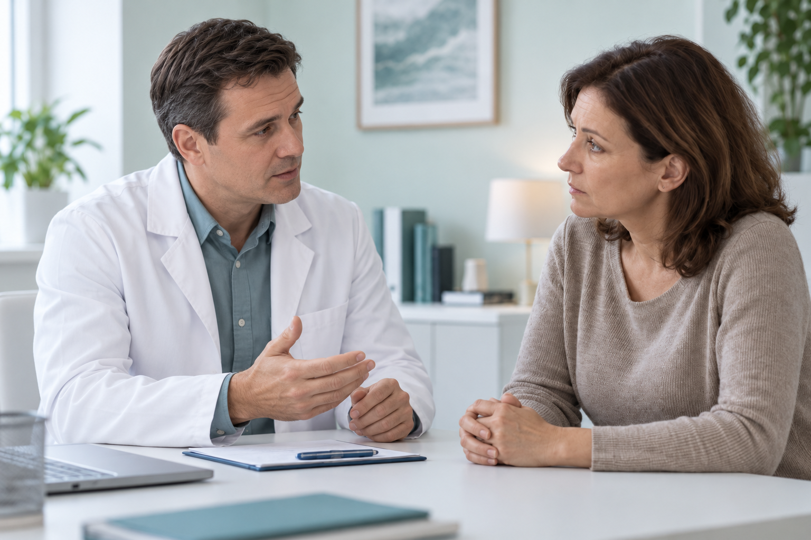

---

## Блок 16: Лицензия минздрава

HTML: `section`, id=``, class=`license`

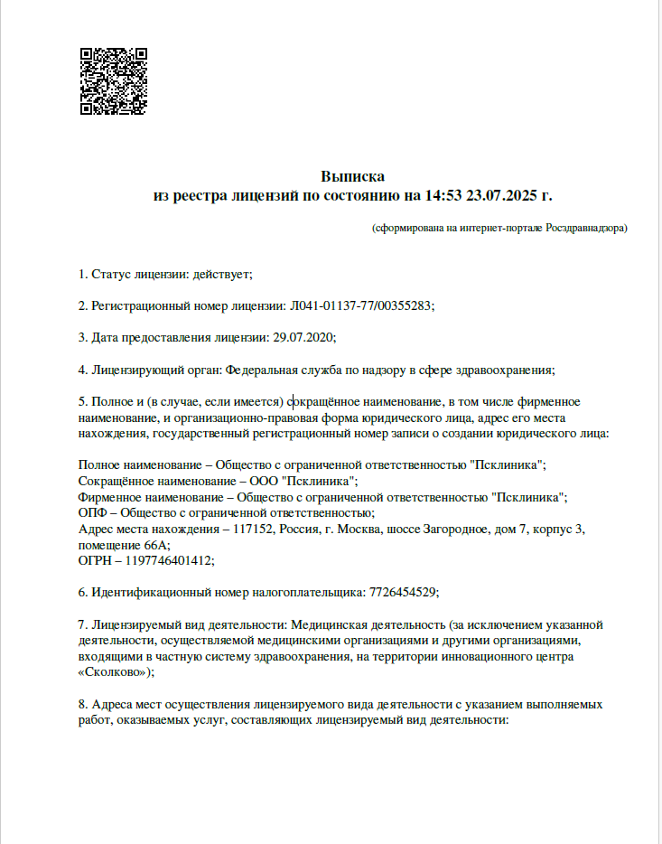

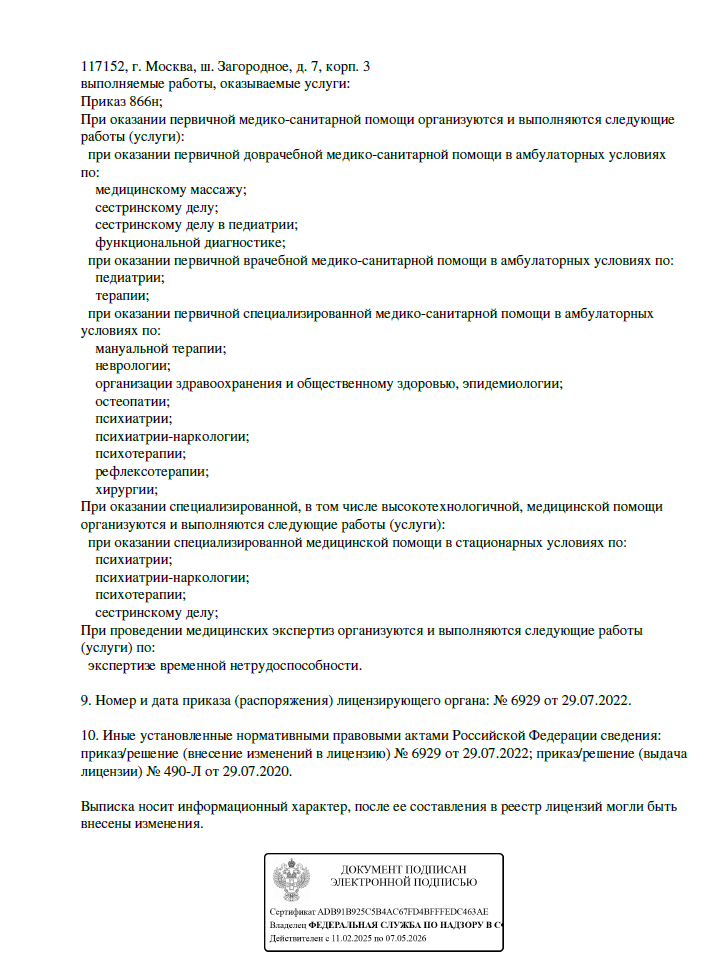

Лист 1                        

Лист 2                        

1 / 2

Документы

## Лицензия минздрава

- Номер лицензии Л041-01137-77/00355283

- Юридические реквизиты ООО «ПСКЛИНИКА» ИНН: 7726454529 ОГРН: 1197746401412 Юридический адрес: Москва, Загородное шоссе, дом 7, корп. 3.

- Адрес клиники Москва, Загородное шоссе, дом 7, корп. 3.

- Адрес стационара Москва, Загородное шоссе, дом 7, корп. 3.

[Посмотреть лицензию полностью](https://narkologicheskaya-klinika.ru/about/license/)

---

## Блок 17: Частые вопросы

HTML: `section`, id=``, class=`faq`

## Частые вопросы

Как быстро приедет врач? 

Срок зависит от адреса и доступности врача. Специалист уточнит ориентир после получения адреса.

Можно ли вызвать врача ночью? 

Да, обращения принимаются круглосуточно.

Сколько стоит выезд? 

Стоимость зависит от состояния и объёма помощи. Предварительный порядок расчёта объяснят до выезда.

Сохраняется ли конфиденциальность? 

Обращение и медицинские данные обрабатываются конфиденциально в соответствии с требованиями законодательства.

Нужно ли согласие пациента? 

Медицинское вмешательство проводится с информированного добровольного согласия, кроме предусмотренных законом случаев.

Что делать, если состояние ухудшается? 

При резком ухудшении или угрозе жизни немедленно звоните 112.

Можно ли сразу организовать госпитализацию? 

Да, если врач после оценки состояния рекомендует стационарный формат.

Какие данные нужно сообщить специалисту? 

Возраст, текущие жалобы, известные заболевания, принимаемые препараты и точный адрес. Не скрывайте важную медицинскую информацию.

Если вопросы останутся — свяжитесь с нами по телефону: [+7 (499) 110-40-03](tel:+74991104003)

[Посмотреть вопросы](https://narkologicheskaya-klinika.ru/narkolog-na-dom/)

---

## Блок 18: Не знаете, какая помощь нужна?

HTML: `section`, id=``, class=`sp2-consult`

Консультация 24/7

## Не знаете, какая помощь нужна?

Опишите состояние пациента дежурному специалисту. Он задаст необходимые вопросы и подскажет дальнейшие действия.

Дежурный специалист 

[+7 (499) 110-40-03](tel:+74991104003)

На связи круглосуточно

Имя

Поле: Ваше имя

Телефон

Поле: +7…

Отправить заявку

Нажимая «Отправить заявку», вы соглашаетесь с обработкой персональных данных.

---

## Блок 19: footer

HTML: `footer`, id=``, class=`footer`

Остались вопросы?

Задать вопрос

[+7 (499) 110-40-03](tel:+74991104003)

Перезвоните мне

[info@ps-clinic.ru](mailto:info@ps-clinic.ru)

Напишите мне

Главное

- [Главная страница](https://narkologicheskaya-klinika.ru/)

- [О клинике](https://narkologicheskaya-klinika.ru/about/)

- [Диагностика и лечение](https://narkologicheskaya-klinika.ru/services/)

- [Специалисты](https://narkologicheskaya-klinika.ru/specialists/)

Лечение зависимостей

- [Лечение алкоголизма](https://narkologicheskaya-klinika.ru/services/alcoholism/) - [Вывод из запоя](https://narkologicheskaya-klinika.ru/services/vyvod-iz-zapoya/) - [Лечение в стационаре](https://narkologicheskaya-klinika.ru/services/lecheniye-v-statsionare/) - [Нарколог на дом](https://narkologicheskaya-klinika.ru/services/ndm/) - [Диагностика алкоголизма](https://narkologicheskaya-klinika.ru/services/diagnosis-of-alcoholism/) - [Мотивация на лечение](https://narkologicheskaya-klinika.ru/services/motivatsiya-na-lecheniye/) - [Реабилитация алкозависимых](https://narkologicheskaya-klinika.ru/services/reabilitatsiya-alkozavisimykh/) - [Амбулаторное лечение](https://narkologicheskaya-klinika.ru/services/ambulatornoye-lecheniye/) - [Кодирование от алкоголизма](https://narkologicheskaya-klinika.ru/services/kodirovaniye-ot-alkogolizma/) - [Пост-реабилитационная поддержка (ПЛП)](https://narkologicheskaya-klinika.ru/services/postreabilitatsionnaya-podderzhka/)

- [Лечение наркомании](https://narkologicheskaya-klinika.ru/services/drug-addiction/) - [Лечение в стационаре](https://narkologicheskaya-klinika.ru/services/lecheniye-narkomanii-v-statsionare/) - [Нарколог на дом](https://narkologicheskaya-klinika.ru/services/nmd2/) - [Мотивация на лечение](https://narkologicheskaya-klinika.ru/services/motivatsiya-na-lecheniye-narkomanii/) - [Виды зависимости](https://narkologicheskaya-klinika.ru/services/vidy-zavisimosti/) - [Амбулаторное лечение](https://narkologicheskaya-klinika.ru/services/ambulatornoye-lecheniye-narkomanii/) - [Двойной диагноз](https://narkologicheskaya-klinika.ru/services/dvoynoy-diagnoz-pri-narkozavisimosti/) - [Пост-реабилитационная поддержка (ПЛП)](https://narkologicheskaya-klinika.ru/services/post-podderzhka-pri-narkozavisimosti/)

Отделения

- [Отделение Психиатрии](https://narkologicheskaya-klinika.ru/services/psychiatry/)

- [Реабилитация](https://narkologicheskaya-klinika.ru/services/rehabilitation/) - [Реабилитация наркозависимых](https://narkologicheskaya-klinika.ru/services/rehabilitation-of-drug-addicts/) - [Реабилитация алкозависимых](https://narkologicheskaya-klinika.ru/services/rehabilitation-of-alcohol-addicts/) - [Другие зависимости](https://narkologicheskaya-klinika.ru/services/drugiye-zavisimosti/) - [Экскурсия в Реабилитационный Центр](https://narkologicheskaya-klinika.ru/services/ekskursiya-v-reabilitatsionnyy-tsentr/) - [Программы реабилитации](https://narkologicheskaya-klinika.ru/services/rehabilitation-programs/) - [Медико-психологическая реабилитация](https://narkologicheskaya-klinika.ru/services/mediko-psikhologicheskaya-reabilitatsiya/) - [Социальная реабилитация](https://narkologicheskaya-klinika.ru/services/social-rehabilitation/) - [Двойной диагноз](https://narkologicheskaya-klinika.ru/services/dvoynoy-diagnoz/) - [Амбулаторная реабилитация](https://narkologicheskaya-klinika.ru/services/ambulatornaya-rehabilitation/)

Услуги и Помощь

- [Нарколог на дом](https://narkologicheskaya-klinika.ru/narkolog-na-dom/)

- [Помощь родственникам](https://narkologicheskaya-klinika.ru/services/pomoshch-rodstvennikam/)

Москва, Загородное шоссе, дом 7, корп. 3

- ©2008—2026 ООО «ПСКЛИНИКА»

- ОГРН: 1197746401412

- ИНН: 7726454529

- Лицензия № Л041-01137-77/00355283

- [Политика конфиденциальности](https://narkologicheskaya-klinika.ru/about/confidential/)

## Всплывающая форма обратной связи

[×](https://narkologicheskaya-klinika.ru/narkolog-na-dom/)

## Обратная связь

Имя

Поле: Ваше имя

Телефон

Поле: +7 (___) ___-__-__

Поле: consent

Отправляя заявку, вы подтверждаете согласие на обработку своих персональных данных

Отправить

Ваше сообщение успешно доставлено.
Скоро с вами свяжутся.

При отправке сообщения вознмкла ошибка.

